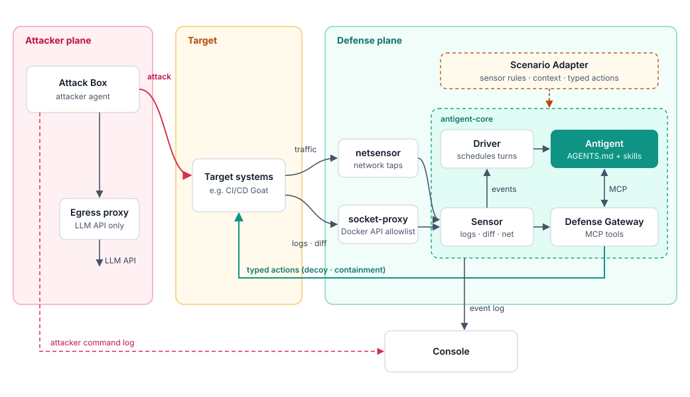

# Antigent Defense Plane

Antigent is an autonomous counter-agent for **authorized, isolated labs**. It observes
only defender-side telemetry from Docker-based targets, predicts an AI attacker's next
steps, and responds through a Defense Gateway with deception, containment, or observation
only.

**Language:** English | [日本語](README_JA.md)

## Project Overview



Antigent provides a complete Defense Plane for AI-driven security operations:

| Component | Description |
|-----------|-------------|
| **Defense Gateway** | The only intervention point. Enforces typed actions, one action per observation, deduplication, and evidence recording. |
| **Sensor** | Continuous observation of target containers (logs, file changes, network flows). |
| **Driver** | Event-driven LLM agent that assesses attacker intent, predicts next steps, and submits defense turns. |
| **Console** | Viewer-only web UI showing attacker activity, defense telemetry, and intervention results. |
| **Scenario Adapter** | Environment-specific integration (CI/CD Goat Caterpillar). |
| **Attack Box** | Optional sample for testing (no Docker socket, no SSH, target-only network). |

The Defense Plane never sees the attacker's commands — only what a defender would see:
logs, file changes, and network events. This ensures the defense operates on the same
information available to a real SOC.

## Quick Start: One-Command Caterpillar Demo

Run the Caterpillar demo with one command.

### Prerequisites

1. **Docker** with Compose on a single Docker host
2. **CI/CD Goat** repository cloned into the distribution root (creates `./cicd-goat`,
   matching the default `.env`; otherwise set `CICD_GOAT_DIR` to your checkout):

   ```sh
   git clone https://github.com/cider-security-research/cicd-goat.git
   ```

3. **uv** package manager (or Python 3.10+)

### Commands

```sh
# 1. Configure (defaults work when CI/CD Goat is at ./cicd-goat)
cp .env.example .env
#    For containment, also set JENKINS_URL / JENKINS_ADMIN_USER / JENKINS_ADMIN_PASSWORD in .env
#    (the lab's Jenkins administrator, as documented by CI/CD Goat). Without them Antigent
#    still plants decoys, and `run` prints "NOTE: Jenkins containment is off".

# 2. Validate configuration (no containers, no model calls)
uv run python live_demo.py dry-run

# 3. Run the demo (fresh target + defense + AUTO attack)
uv run python live_demo.py run
```

Open the Console at <http://127.0.0.1:8765> to watch the attack and defense in real time.
The Console remains running after the attack for review.

```sh
# 4. Clean up when done
uv run python live_demo.py stop

# 5. Later: review an exported run offline (Console Export button; no Docker needed)
uv run python live_demo.py view ~/Downloads/<session>-merged.jsonl   # http://127.0.0.1:8766
```

### What Happens During a Run

1. **Fresh CI/CD Goat Caterpillar** starts (Gitea, Jenkins, prod target)
2. **Defense baseline** observes the target (60 seconds)
3. **OpenCode AUTO attack** begins against Caterpillar
4. **Defense interventions** occur as the attacker progresses:
   - `gitea_repo_file`: Plant decoy files in repositories
   - `jenkins_disable_job`: Contain dangerous pipeline jobs (requires credential)
5. **Native receipt & reobservation**: Each intervention is verified against the target
6. **Recovery**: Defense actions are undone at run end

### Model Selection

By default, the demo uses OpenCode's free/built-in models:
- **Attacker**: `opencode/glm-5.3-flash-free`
- **Defender**: `opencode/glm-5.3-flash-free`

No API key required. Run `opencode models` to see the free models available in
your OpenCode version.

> **Data-use note**: with any `opencode/*` model, prompts and tool output
> (including lab secrets such as the challenge flag) are sent to OpenCode's
> model provider. The default models above follow a zero-retention, no-training
> policy, but some other free models may retain data or use it to improve the
> model. Check <https://opencode.ai/docs/zen/#privacy> before choosing a model,
> and never run the demo against real systems or real credentials.

To use OpenAI GPT-4 instead (subject to OpenAI's data policy), set in `.env`:

```sh
ATTACKER_MODEL=openai/gpt-4o
DEFENDER_MODEL=openai/gpt-4o
OPENAI_ATTACKER_KEY=sk-...
OPENAI_DEFENDER_KEY=sk-...
```

## Documentation

| Document | Description |
|----------|-------------|
| [docs/usage.md](docs/usage.md) | Step-by-step demo setup and result verification |
| [docs/ja/usage.md](docs/ja/usage.md) | 日本語のデモ設定と結果確認手順 |
| [docs/configuration.md](docs/configuration.md) | Addresses, ports and other environment-specific settings |
| [docs/architecture.md](docs/architecture.md) | System design |
| [docs/harness.md](docs/harness.md) | Constraints on the defender's agent harness (OpenCode) |
| [docs/security.md](docs/security.md) | Security model and boundaries |

## Safety

- Only use Antigent on systems you are authorized to test
- Never point Antigent at production systems
- The `antigent` container mounts `runs/defense/` only, has no Docker socket,
  and reaches targets through the read-only socket proxy
- The Console container is viewer-only and has no Docker access
- Keep API keys in `.env` (never in logs, manifests, or version control)

## License

Antigent's self-authored distribution is licensed under [Apache License 2.0](LICENSE).
See [NOTICE](NOTICE). Downloaded tools and external targets retain their respective
upstream licenses and notices.
