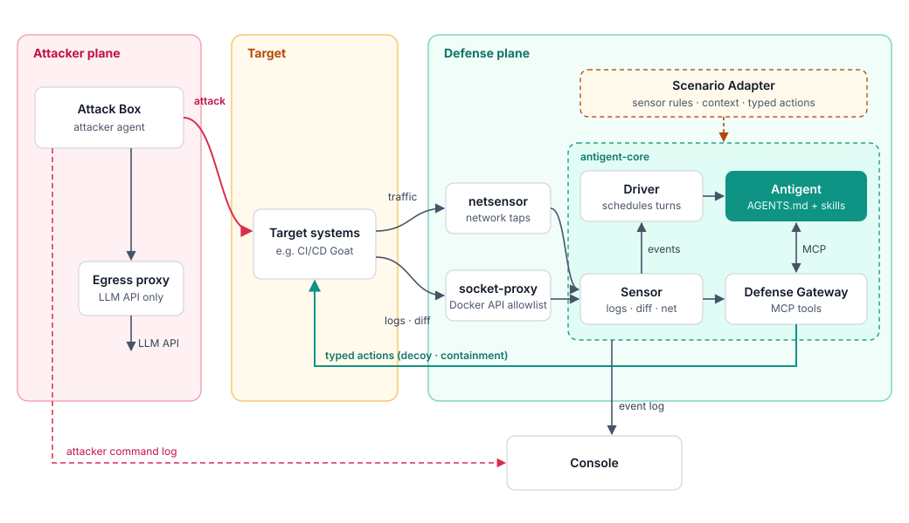

# Antigent Defense Plane

Antigentは、**承認された隔離ラボ**で使用する自律Counter-Agentです。Dockerベースの
対象環境から防御側が取得できるtelemetryだけを観測し、AI攻撃者の次の行動を予測して、
Defense Gateway経由でdeception、containment、または観測継続だけを実行します。

**言語:** [English](README.md) | 日本語

## プロジェクト概要



AntigentはAI駆動のセキュリティ運用向けに完全なDefense Planeを提供します:

| コンポーネント | 説明 |
|--------------|------|
| **Defense Gateway** | 唯一の介入ポイント。型付きアクション、1観測につき1アクション、重複排除、証拠記録を強制 |
| **Sensor** | 対象コンテナ（ログ、ファイル変更、ネットワークフロー）の継続的観測 |
| **Driver** | 攻撃者の意図を評価し、次の行動を予測して防御ターンを送信するイベント駆動LLMエージェント |
| **Console** | 攻撃者活動、防御telemetry、介入結果を表示するビューア専用Web UI |
| **Scenario Adapter** | 環境別の統合（CI/CD Goat Caterpillar） |
| **Attack Box** | テスト用の任意サンプル（Docker socket・SSHなし、target専用ネットワークのみ） |

Defense Planeは攻撃者のコマンドを見ず、防御者が見るもの——ログ、ファイル変更、
ネットワークイベント——だけを観測します。これにより、実際のSOCが利用できる
情報と同じ情報で防御が動作します。

## Quick Start: ワンコマンドCaterpillarデモ

Caterpillarデモを1コマンドで実行できます。

### 前提条件

1. 単一Dockerホスト上の**Docker**（Compose含む）
2. **CI/CD Goat**リポジトリを配布物のrootにclone（`./cicd-goat`が作成され、
   既定の`.env`と一致します。別の場所にある場合は`CICD_GOAT_DIR`を設定）:

   ```sh
   git clone https://github.com/cider-security-research/cicd-goat.git
   ```

3. **uv**パッケージマネージャー（またはPython 3.10以降）

### コマンド

```sh
# 1. 設定（CI/CD Goatが./cicd-goatにある場合は既定のままで動作）
cp .env.example .env
#    containmentを使う場合は、.envのJENKINS_URL / JENKINS_ADMIN_USER / JENKINS_ADMIN_PASSWORDも設定
#    （labのJenkins管理者。CI/CD Goatのドキュメントに記載）。未設定でもdecoyは設置され、
#    `run`は"NOTE: Jenkins containment is off"と表示します。

# 2. 設定検証（container・model呼出しなし）
uv run python live_demo.py dry-run

# 3. デモ実行（fresh target + defense + AUTO attack）
uv run python live_demo.py run
```

<http://127.0.0.1:8765>を開いてリアルタイムで攻撃と防御を観察してください。
Consoleは攻撃終了後も残り、結果を確認できます。

```sh
# 4. 終わったら停止
uv run python live_demo.py stop

# 5. 後から：exportしたrunをオフラインで見直す（ConsoleのExportボタン、Docker不要）
uv run python live_demo.py view ~/Downloads/<session>-merged.jsonl   # http://127.0.0.1:8766
```

### 実行中に起こること

1. **Fresh CI/CD Goat Caterpillar**が起動（Gitea、Jenkins、prod target）
2. **Defense baseline**がtargetを観測（60秒）
3. **OpenCode AUTO攻撃**がCaterpillarに対して開始
4. **防御介入**が攻撃者の進行に応じて発生:
   - `gitea_repo_file`: リポジトリにdecoyファイルを配置
   - `jenkins_disable_job`: 危険なパイプラインジョブを封じる（credential必要）
5. **Native receipt & 再観測**: 各介入がtargetに対して検証される
6. **Recovery**: 実行終了時に防御アクションが元に戻される

### Model選択

既定ではOpenCodeのfree/built-inモデルを使用:
- **攻撃者**: `opencode/glm-5.3-flash-free`
- **防御者**: `opencode/glm-5.3-flash-free`

API keyは不要です。`opencode models`を実行して、お使いのOpenCode versionで
利用可能なfree modelを確認してください。

> **データ利用に関する注意**: `opencode/*` modelを使う場合、promptとtool出力
> （challenge flag等のlab内secretを含む）はOpenCodeのmodel providerへ送信されます。
> 上記の既定modelはzero-retention・学習不使用のpolicyですが、他のfree modelの中には
> データを保持したりmodel改善に利用したりするものがあります。model選択前に
> <https://opencode.ai/docs/zen/#privacy> を確認し、実システムや実credentialに対して
> デモを実行しないでください。

OpenAI GPT-4を使用する場合（OpenAIのデータpolicyに従う）は`.env`で設定:

```sh
ATTACKER_MODEL=openai/gpt-4o
DEFENDER_MODEL=openai/gpt-4o
OPENAI_ATTACKER_KEY=sk-...
OPENAI_DEFENDER_KEY=sk-...
```

## ドキュメント

| ドキュメント | 説明 |
|------------|------|
| [docs/usage.md](docs/usage.md) | デモ設定と結果確認の手順（英語） |
| [docs/ja/usage.md](docs/ja/usage.md) | デモ設定と結果確認の手順（日本語） |
| [docs/ja/configuration.md](docs/ja/configuration.md) | IP・portなど環境ごとの設定 |
| [docs/architecture.md](docs/architecture.md) | システム設計 |
| [docs/ja/harness.md](docs/ja/harness.md) | defenderのagent harness（OpenCode）に対する制約 |
| [docs/security.md](docs/security.md) | セキュリティモデルと境界 |

## 安全性

- 承認された環境だけで使用してください
- 本番環境には絶対に向けないでください
- `antigent`コンテナは`runs/defense/`だけをmountし、Docker socketを持たず、
  read-only socket proxy経由でのみtargetへ到達します
- Consoleコンテナはviewer専用で、Dockerへのアクセスがありません
- API keyは`.env`に保管してください（ログ、manifest、バージョン管理には入れない）

## License

Antigentの自作配布物は[Apache License 2.0](LICENSE)です。[NOTICE](NOTICE)も
参照してください。ダウンロードされるtoolと外部targetには、それぞれの
upstream licenseとnoticeが適用されます。
